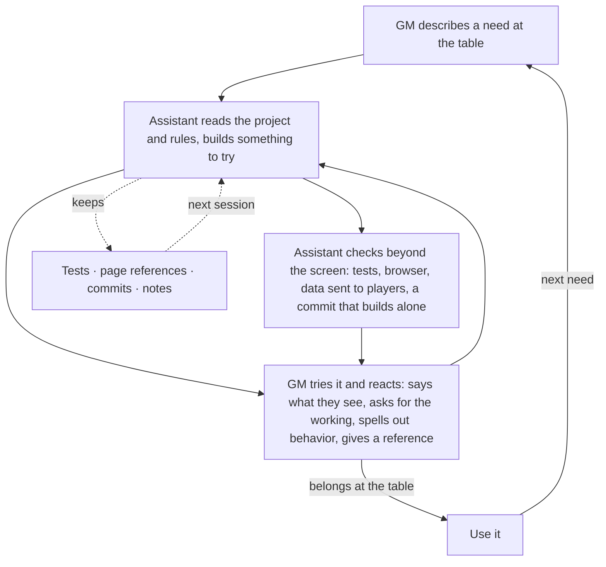
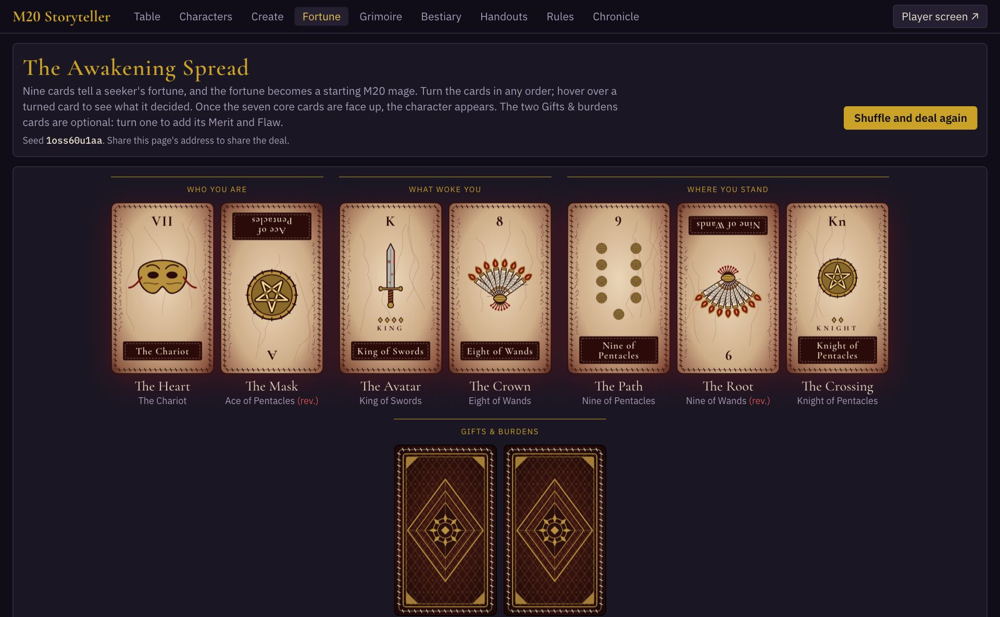
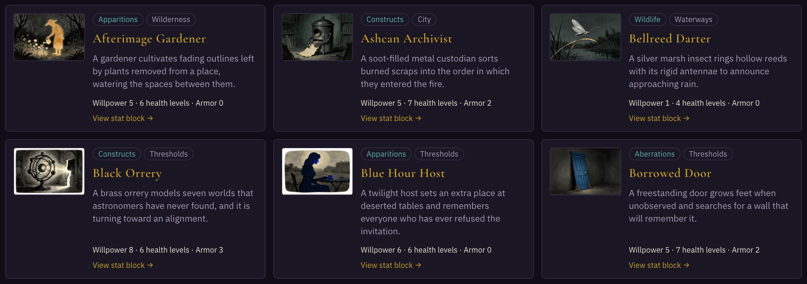
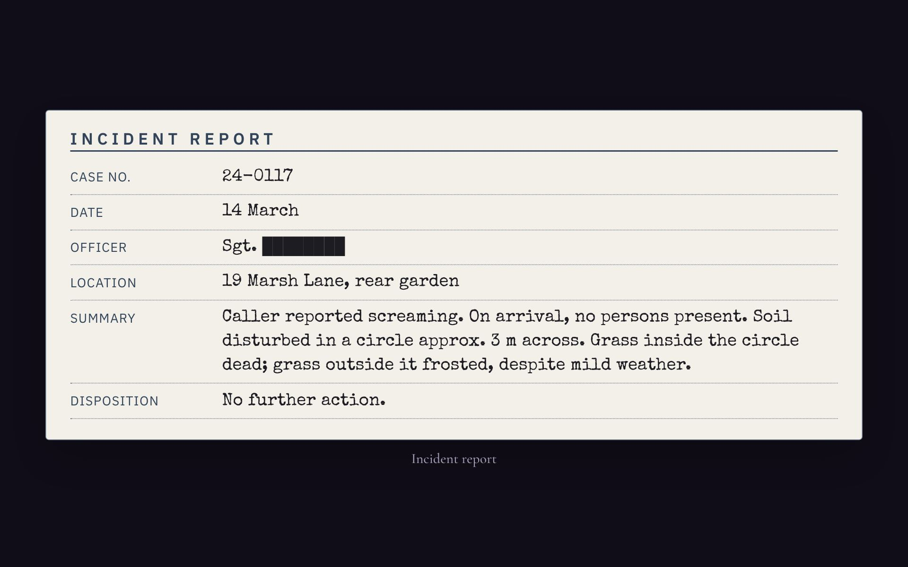

# Building RPG tools with a coding assistant

## Lessons from M20-Storyteller

## Introduction

M20-Storyteller is a browser application for running *Mage: The Ascension*. It has character sheets that roll their own dice, a magick and Paradox roller, a tarot reading that becomes a starting character, a catalog of over a thousand generated rotes, a bestiary, handout templates and a second window for the players' screen. It grew out of preparing a one-shot: finishing the characters and NPCs, checking the scenario, and getting game information into a form that worked at the table.

Nearly all of it was written by coding assistants (Claude Code and Codex), directed by the GM in plain conversation. This guide is for GMs who know what they want at the table and want an assistant to build it. It covers how to ask, how to correct, what to check, and the mistakes that only showed up later.

Quotations in this guide are the GM's actual requests, typos included. They are short, informal and often written mid-session; that turned out to be enough. Prompts marked **Try** are suggestions, not quotations.

## 1. Start with something you need at the table

The tarot generator began as one sentence:

> Add a character generation app that uses tarot cards to tell the user's fortune. The combination of cards produces the character.

That request names an activity and an outcome, and leaves the design open. The assistant chose the spread, decided which card fed which trait and built the screen. The GM then reacted to something real instead of reviewing a plan on paper.

Starting this way works when the assistant can see what it needs. Point it at the material: the scenario, the character sheet, the rules you use, a screenshot of what bothers you. The first scenario review found incomplete characters, NPCs without usable statistics, an investigation that leaned on a single witness, and a dice tray that added die faces instead of counting M20 successes. A request to "make some player aids" would not have uncovered any of that.

If you want a plan before any code, say so. For most features it is faster to let the assistant build a first version and correct it.

## 2. Correct in table terms

Most of the tool was shaped by short corrections. They work best when they describe what is wrong with the result, not how to fix the code.

**Say what you see.** After a request to make the tarot screen more compact, the assistant shrank the cards and text. The correction restated the goal:

> No...look at the page. The cards and text don't need to be smaller. There needs to be less blank space in between.

**Narrow a style direction when it overshoots.** "Make the artwork less magickal and more Clive Barkeresque" produced hooks and other imagery from one particular film. Two corrections set the boundary:

> don't use hooks for wands or scalpels for swords

> Remove the hooks from the other cards, too. I said Clive Barker, not Hellraiser specifically.

**Keep what works.** "The faces look good. I prefered the last set of backs." tells the assistant what to leave alone, which matters as much as what to change.

**Spell out behavior when it matters.** A vague complaint about the optional cards was misread. The fix was a precise description of the interaction:

> Start with all nine cards face down. The user can click on them one by one. If the user turns over all the non-merit/flaw cards, the character is generated without them. If the merit/flaw cards are turned over, they are added to the character. Cards may still be turned in any order. If the user hits "reveal all", only the seven core cards are turned over; the user will still need to turn over the merits/flaws manually.

That paragraph is effectively a test case, and it was used as one.

**Show, don't describe, when words fail.** The dice icon took two attempts ("It looks a little odd. Try again.") before the GM supplied a link to a picture of the right shape. One reference image ended the back-and-forth.

## 3. Check the assistant's reading of the rules

Give the assistant the rules and ask it to keep page references. M20-Storyteller's dice code cites the core book next to each mechanic: magick difficulty, the Willpower cap on casting rolls, Paradox from a casting roll, difficulties above 10, and initiative as one die plus Dexterity plus Wits. Character creation cites the creation steps and the freebie chart. Those references let the GM check a result against the book in seconds.

Extracted rulebook text needs its own check. During extraction, the rating dots in the M20 books (`•`, `••`, `•••`, increasing ability) were turned into ordinary list bullets, which deletes the information they carry. Headings, column order and tables needed repairs too.

When the output of a generator is opaque, ask to see the working. These were consecutive requests:

> How do the cards relate to attributes and skills?

> Explain clearly.

> Show me the math.

The result was an on-screen explanation that uses the generator's actual numbers, so the explanation cannot drift from the result.

Tests should cover the distinctions that matter in play. An M20 botch requires no successes before 1s are subtracted; a roll whose successes are all cancelled is a failure, not a botch. The dice tests check exactly that case, because a test of the final total alone would miss it.

**Try:** "Show the rule you used, with its page, the inputs and the calculation. If the extracted text is ambiguous, say so before changing code."

A citation shows where a rule came from. It does not prove the code follows it.

## 4. Carry one example through the whole feature

Before asking for a large catalog, follow one entry all the way through. For a bestiary creature: add it as an NPC, edit its traits, apply damage, save and reload.

The catalog entry and the NPC must be separate. Two copies of the same creature need their own health and Willpower, and editing one must not change the other or the template. M20-Storyteller has tests for that.

Then try a creature that does not fit a human sheet. The bestiary includes ratings above 5, unusual health tracks and creatures with no physical body at all. Those exposed assumptions that ordinary NPCs never would: the exporters filled in missing Social Attributes with a rating of 1, and the importer could not read a health track written as penalties.

**Try:** "Add one ordinary creature and one that needs an unusual sheet. Take both through adding, editing, damage, saving and reloading. Make two copies of one and confirm they stay independent."

## 5. Make generators explainable and controllable

A generator has to produce a valid character, but the person using it also has to understand why it got that character and be able to steer it.

Change one choice at a time and watch what else changes. When the two optional tarot cards were added for Merits and Flaws, choosing one changed the other. The cause was a shared random stream; the fix gave each card position its own seeded stream. A test now turns the cards in different combinations across hundreds of seeds and checks that each card keeps its own Merit and Flaw. Each reading also has a seed you can share, so a strange result can be reproduced.

Some problems only appear in the running app. The optional cards first appeared already face up, even though the code turned nothing over. The cause was a development-mode quirk that ran a start-up step twice. The fix was the interaction spelled out in section 2: every card starts face down, and only a click turns one.

## 6. Keep the content yours

The bestiary started as:

> Add a Bestiary to this project. Look for resources in [the rulebook folder].

The next question changed its direction:

> Is there a licensing issue with using creates from the books?

> Replace the monsters/animals from the books with original ones.

Every creature, stat block and encounter rule was then written fresh, and the book-derived data was deleted. For a tool you plan to publish, ask the licensing question early. It is much cheaper before the content exists.

The same care applies to the small print. The app is published under a community content licence that requires a specific notice. An early version of the notice also said the material was "used with permission", which the GM had never been given. The GM asked whether it was true, then had to ask again when the first fix left the phrase in place:

> You didn't fix this: "and are used with permission."

Practical rules that held up:

- Keep rulebook text out of the public repository. M20-Storyteller ignores the books folder in git, and its rules search reads files the user loads into their own browser.
- Use generic descriptions in generated content. The rote catalog draws on horror and science-fiction influences without naming any of them.
- Read legal notices yourself. An assistant will happily write a plausible one.

## 7. Review generated images one at a time

Each bestiary creature has an illustration rendered locally with an image model. The prompt and seed for every image are saved in the project, so any image can be redrawn or adjusted without guessing how it was made.

A complete set of image files did not mean a complete set of usable images. Reviewing a batch of sixteen found:

- a figure drawn nude, which had no place in a public app;
- a creature's name lettered across the picture;
- an eel that looked like a friendly cartoon snake;
- a monstrous swan that took three prompts before it looked like more than a swan.

Review each image beside its entry, at the size the app shows it. Check anatomy, tone and anything that would be awkward to show at a table. Then fix the prompt rather than settling for the image.

## 8. Test what players receive, not just what they see

"Show it to the players" needs a definition. In M20-Storyteller, the players' screen is a second browser window on the same computer, kept in sync with the GM's window. That is different from players joining from their own devices. Settle which you mean before the assistant designs anything.

Then check the data, not only the display. Handouts can black out secrets written as `[[like this]]`. The assistant built the feature, reported that secrets "never reach" the players' window, and wrote a test to prove it. The claim was false. The test checked the blacking-out function, but the GM's window still sent the full text, and the players' window blacked it out only when drawing the page. Anyone who opened the browser's developer tools on the players' window could read the secret.

A review by a second assistant caught it. The fix moved the redaction to before the handout is sent, and the new test inspects the message that actually goes to the players' window.

**Try:** "Check what the player view receives, not just what it shows. Reveal, edit, hide and reload, and report any path that sends GM-only text."

Saving deserves the same scepticism. Fill in a realistic example, reload, export, import and compare. "Tests passed" says nothing about whether anyone opened the players' window or reloaded the page.

## 9. Two assistants, one project

For part of the project, two assistants worked in the same folder at once: one building the bestiary, the other the player screen and handouts. That works, with some rules.

- **Commit only your own changes.** The rule was that each assistant commits its own work and leaves the other's alone. Some files held changes from both, so the assistant committed only its own lines from those files.
- **Check that a commit stands on its own.** Before committing, the assistant built and tested a copy of the project with only its own changes. That guards against work that quietly depends on the other assistant's unfinished files.
- **Expect to see half-finished work.** At one point the other assistant's file had a syntax error mid-edit. The right response was to leave it alone and test elsewhere, not to "fix" it.

If you run assistants in parallel, tell each one what the others are doing.

## 10. Know what is local, committed and published

Three different things can all feel like "done":

- the change works on your computer;
- the change is committed;
- the change is published and live.

After the rote catalog gained three new styles, the GM reported:

> I dont see them in the grimoire

The code was fine; it had not been published. Ask the assistant to say which of the three states a change is in, especially before you show it to anyone.

The same report surfaced a second problem: "It still says 'The six hands'". The count was typed into the page by hand. The fix was to compute it from the data. Any number that describes your content (creatures, rotes, templates) should come from the content itself.

## 11. Leave enough to continue

M20-Storyteller was built over many sessions. A new session has to recover the current state without treating every old request as unfinished or every completion report as proof.

Different things keep different kinds of memory:

- **Tests** keep behavior. The fixed-seed tarot test and the handout-redaction test will fail if anyone breaks those guarantees.
- **Page references** in the code keep rule decisions and where they came from.
- **Commit messages** keep what changed and why, in the order it happened.
- **Notes in the project** keep the things none of the above can: preferences ("no rulebook text in the repo"), open problems, and decisions that were argued out.

At the end of a substantial change, ask for a short record:

**Try:** "Record what changed, which rule interpretations we settled, what you actually checked and what is still open. Next time, compare those notes with the code before continuing."

Make each note specific enough to act on. "Improve tarot generation" is vague. "Optional cards must not change the core allocation; keep the fixed-seed test" tells the next session what to protect.
